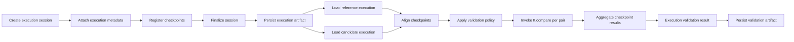
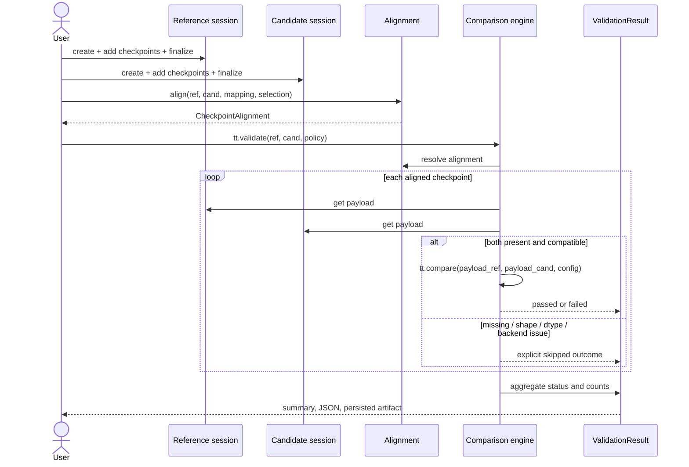

# Execution model

This document is the architectural contract for TensorTrail 0.2.0. It defines
the execution-level data model that sits above the existing tensor comparison
engine. It describes what is implemented in this milestone, what is deliberately
deferred, and which rules the implementation and tests must preserve.

## 1. Objectives

TensorTrail 0.1.0 answers one question well:

```python
report = tt.compare(reference_tensor, candidate_tensor)
```

That question is necessary but not sufficient for inference validation. A real
inference run produces many tensors at many stages. Comparing individual tensors
does not answer:

- which execution produced a tensor;
- which model, framework, device, precision, and input were used;
- whether both executions captured the same checkpoints;
- which checkpoint first showed an observed numerical difference;
- whether a difference is a tolerance failure, a missing capture, a shape
  change, a dtype change, or an execution error.

The 0.2.0 execution model adds those facts without changing the numerical
engine. It moves the public workflow from

```text
compare(reference_tensor, candidate_tensor)
```

toward

```text
validate(reference_execution, candidate_execution)
```

while retaining `tt.compare()` as the numerical primitive underneath every
checkpoint comparison.

### 1.1 Why execution-level representation is required

A tensor compared in isolation has no stable meaning across runs. The same
numeric values can come from different model versions, different layers,
different dtypes, or different hardware. Execution-level objects attach stable
identity and provenance to each captured tensor. They also make missing and
incompatible captures explicit instead of silently reducing a multi-checkpoint
validation to whichever tensors happened to line up.

### 1.2 What is new in 0.2.0

Implemented:

- `ExecutionMetadata`: immutable provenance for one execution.
- `TensorCheckpoint`: immutable metadata for one captured tensor.
- `CheckpointRegistry`: deterministic checkpoint identity and lookup.
- `ExecutionSession`: explicit lifecycle, checkpoint registration, and payload
  storage separated from metadata.
- `ValidationPolicy`: tolerance and aggregation policy that reuses
  `ComparisonConfig`.
- `CheckpointAlignment`: deterministic matching with explicit mappings and
  structured missing-checkpoint results.
- `ValidationResult`: execution-level status, checkpoint results, alignment,
  summaries, and strict JSON.
- `FilesystemStorage`: local, versioned, checksummed execution and validation
  artifacts.
- `tt.validate()`: execution-level validation that calls the existing comparison
  engine for every matched tensor pair.
- Backward compatibility with the complete 0.1.0 public API.

Not implemented in this milestone:

- automatic framework hooks, activation capture, graph tracing, or model
  patching;
- GPU-native comparison or implicit accelerator-to-host transfers;
- cloud/object storage;
- distributed execution;
- a diagnostic hypothesis engine. The result records measurements and explicit
  status; it does not claim to identify the exact operation that caused a
  difference.

## 2. Architectural boundaries

The existing division of responsibility is preserved.

| Layer | Responsibilities |
| --- | --- |
| Python execution layer | Session lifecycle, metadata validation, checkpoint registration, payload references, artifact persistence, policy validation, alignment, result aggregation, reporting. |
| Python comparison layer | Input normalization, provenance, backend selection, report assembly, JSON/HTML serialization. |
| Rust numerical core | Shape/option validation, fused metrics, reductions, deterministic parallel execution. |
| Framework adapters | Explicit, user-directed normalization of framework tensors. No automatic capture in 0.2.0. |

The Rust engine remains independent of PyTorch, TensorFlow, ONNX, and model
architectures. The execution model does not import PyTorch at package import
time and does not add a Rust dependency.

### 2.1 Explicit data movement

- Registering a NumPy array stores a reference to that array; it does not copy
  its contents into checkpoint metadata.
- Registering a CPU PyTorch tensor records its shape, dtype, byte size, and
  device without converting it to NumPy. Validation converts it through the
  existing explicit CPU adapter when a comparison is executed.
- Accelerator, quantized, and non-strided tensors are rejected at registration
  or comparison. TensorTrail never silently calls `.cpu()`.
- Persisting an execution artifact currently requires NumPy-compatible payloads.
  A PyTorch payload must be converted explicitly before persistence. This
  limitation is enforced with an actionable error rather than an implicit
  transfer or dtype conversion.

## 3. Module organization

```text
python/tensortrail/
  execution/
    __init__.py       public execution exports
    metadata.py       ExecutionMetadata, timestamps, JSON metadata validation
    checkpoint.py     TensorCheckpoint and metadata-only tensor description
    registry.py       CheckpointRegistry
    session.py        ExecutionSession and lifecycle rules
    artifacts.py      ExecutionStorage protocol and FilesystemStorage

  validation/
    __init__.py       public validation exports
    policy.py         ValidationPolicy
    alignment.py      CheckpointAlignment and align_checkpoints()
    results.py        ValidationResult and CheckpointValidationResult
    engine.py         validate() orchestration and status aggregation
    reporting.py      validation JSON, summaries, and reload

  comparison/engine.py  existing numerical orchestration (unchanged)
  core/result.py        existing comparison report types (unchanged)
  reporting/            existing comparison JSON/HTML writers (extended with
                        comparison-report reload support)
```

No empty or speculative modules are created. `tt.compare()` remains in
`api.py`; `tt.validate()` is added to the same public namespace and delegates to
`validation.engine`.

## 4. Data contracts

All public models are frozen dataclasses or read-only session objects. Mappings
supplied by callers are copied; their top level is exposed through a read-only
mapping. Timestamps are timezone-aware UTC `datetime` values in Python and ISO
8601 strings in JSON.

### 4.1 ExecutionMetadata

Represents the environment and configuration of one inference execution.

| Field | Required | Meaning |
| --- | --- | --- |
| `execution_id` | generated | Artifact-safe stable identifier. |
| `model_id` | yes | Model or component identifier. |
| `model_version` | yes | Model version. Use an explicit value such as `"unversioned"` if none exists. |
| `model_fingerprint` | no | Hash or other stable model fingerprint. |
| `framework` | yes | Framework name, normalized to lower case. |
| `framework_version` | no | Framework version string. |
| `device_type` | no | Execution device class, for example `cpu`, `cuda`, `mps`. |
| `device_name` | no | Human-readable device name. |
| `device_identifier` | no | Stable device identifier. |
| `precision` | yes | Declared execution precision, normalized to lower case. |
| `input_identifier` | no | Identifier for the input sample or batch. |
| `dataset_identifier` | no | Dataset or evaluation split identifier. |
| `execution_timestamp` | generated | Timezone-aware execution time. |
| `execution_configuration` | no | JSON-compatible configuration metadata. |
| `custom_metadata` | no | Additional JSON-compatible metadata. |

Rules:

- Identifiers are non-empty strings. `execution_id` must also be safe as a
  single filesystem path segment.
- Naive timestamps are rejected. Aware timestamps are converted to UTC.
- Unknown fields are rejected when loading metadata from JSON.
- Arbitrary executable objects, tensors, and non-JSON values are rejected.
- Credentials and environment secrets must not be stored. TensorTrail cannot
  detect a secret supplied as ordinary metadata; this is a caller
  responsibility and is stated in the documentation.
- JSON serialization is deterministic for the same metadata.

### 4.2 TensorCheckpoint

Represents checkpoint metadata for one tensor captured during an execution.

| Field | Required | Meaning |
| --- | --- | --- |
| `checkpoint_id` | generated | Artifact-safe stable identifier. |
| `execution_id` | yes | Owning execution. |
| `checkpoint_name` | yes | Stable logical name, unique within the session. |
| `checkpoint_index` | generated | Unique non-negative execution order. |
| `stage_name` | no | Logical model stage, for example `encoder`. |
| `operation_type` | no | Operation class, for example `matmul` or `layer_norm`. |
| `tensor_shape` | yes | Shape metadata. |
| `tensor_dtype` | yes | Declared dtype metadata. |
| `tensor_nbytes` | yes | Declared payload byte size. |
| `tensor_source` | yes | `numpy`, `array-like`, `torch`, or `artifact`. |
| `tensor_device` | yes | Device of the registered payload, not the execution device. |
| `tensor_reference` | yes | `memory` or `artifact`; identifies where the payload lives. |
| `capture_timestamp` | generated | Timezone-aware capture time. |
| `metadata` | no | Additional JSON-compatible metadata. |

Checkpoint metadata and tensor payloads are deliberately separate:

```text
ExecutionSession
  metadata          -> ExecutionMetadata
  registry          -> TensorCheckpoint metadata (no tensor payload)
  private payloads  -> tensor objects keyed by checkpoint_id
```

A checkpoint never embeds a tensor in its serialized metadata. A session
retrieves a payload explicitly with `session.get_tensor(checkpoint_id)`.
Registration does not copy a NumPy array or transfer a PyTorch tensor.

### 4.3 ExecutionSession

One complete inference execution.

States:

```text
CREATED -> RECORDING -> COMPLETED
   |          |
   +----------+-----> FAILED
```

Legal transitions:

- `create()` produces `CREATED`.
- The first successful checkpoint registration transitions `CREATED` to
  `RECORDING`.
- `finalize()` transitions `CREATED` or `RECORDING` to `COMPLETED`.
- `fail(reason)` transitions `CREATED` or `RECORDING` to `FAILED`.
- `COMPLETED` and `FAILED` are terminal.
- Registering after finalization, finalizing twice, failing a completed
  session, or finalizing a failed session raises `ExecutionStateError`.
- An empty session may be finalized. Validation of an empty session returns
  `INCOMPLETE`; it never fabricates a pass.

A session is a single-writer object. It is not thread-safe. Its public status
and checkpoint views are read-only.

### 4.4 CheckpointRegistry

Rules:

- Checkpoint IDs are unique within a session.
- Checkpoint names are unique within a session.
- Checkpoint indices are unique within a session.
- Every checkpoint must declare the registry's execution ID.
- Lookups are by ID or by name. Iteration and enumeration use ascending
  `checkpoint_index`, never dictionary insertion order.
- Duplicate IDs, names, or indices raise `CheckpointError`.
- A missing lookup raises `CheckpointNotFoundError`.

Duplicate checkpoint names are not permitted. This makes name-based alignment
unambiguous. A future milestone may introduce scoped names; it must then define
a new identity and alignment rule rather than silently changing this one.

### 4.5 ValidationPolicy

The policy reuses `ComparisonConfig` for numerical validation. It adds only
execution-level decisions.

| Field | Default | Meaning |
| --- | --- | --- |
| `metrics` | existing default metrics | Metrics requested from each comparison. |
| `atol`, `rtol` | `1e-6`, `1e-5` | Per-element tolerance. |
| `relative_epsilon` | `1e-12` | Relative-error denominator floor. |
| `equal_nan` | `True` | Whether corresponding NaNs match. |
| `backend` | `rust` | Explicit backend selection; no fallback. |
| `require_all_checkpoints` | `True` | Missing checkpoints are required and affect status. |
| `fail_on_missing_checkpoints` | `False` | A required missing checkpoint makes the result `FAILED` instead of `INCOMPLETE`. |
| `fail_on_shape_mismatch` | `False` | A matched shape mismatch makes the result `FAILED` instead of `INCOMPLETE`. |
| `fail_on_dtype_change` | `False` | A dtype change is a policy failure and the comparison is skipped. |
| `checkpoint_selection` | `None` | `None` validates all aligned checkpoints; otherwise only the named checkpoints are validated. |
| `aggregation_strategy` | `all` | `all` requires every matched checkpoint to pass; `any` passes if at least one matched checkpoint passes. |

Validation:

- Metric names, tolerances, epsilon, backend, and booleans are validated by
  constructing a `ComparisonConfig`; tolerance logic is not reimplemented.
- `fail_on_missing_checkpoints=True` requires
  `require_all_checkpoints=True`, because optional missing checkpoints cannot
  fail validation.
- Selection names must be non-empty, unique strings. Every selected name must
  exist in at least one execution; an unknown selection raises `AlignmentError`.
- `aggregation_strategy` is `"all"` or `"any"` (case-insensitive).

### 4.6 CheckpointAlignment

Alignment is deterministic and structured.

Matching order:

1. An explicit mapping supplied to `align_checkpoints(mapping=...)`. Keys are
   reference checkpoint IDs or names; values are candidate checkpoint IDs or
   names. ID resolution takes precedence over name resolution.
2. A unique checkpoint name present in both executions.
3. Otherwise the reference checkpoint is reported as missing in the candidate,
   and the candidate checkpoint is reported as missing in the reference.

Checkpoints are never matched solely by list position. Reordering checkpoints
does not change a name-based match.

Alignment records:

- reference and candidate checkpoint IDs and names;
- the match rule (`explicit`, `name`, or `unmatched`);
- reference and candidate stage names;
- metadata mismatches: `stage_name`, `operation_type`, `tensor_shape`, and
  `tensor_dtype` when the values differ.

Shape and dtype mismatches do not prevent alignment; they are handled by the
validation policy. Missing checkpoints and duplicate names are never silently
dropped. Duplicate names in a registry or an externally constructed session
raise `AlignmentError`.

Explicit mappings are validated completely. An unknown mapping endpoint,
duplicate candidate endpoint, or a name match that reuses a candidate already
consumed by an explicit mapping raises `AlignmentError`.

An alignment supplied to `tt.validate()` must cover every checkpoint in both
sessions unless a `checkpoint_selection` is configured. A partial alignment is
rejected rather than silently narrowing the validation scope. When a selection
is used, the alignment's selection must equal the policy's selection.

`checkpoint_selection` is applied after alignment. It filters the structured
alignment entries to the selected checkpoint names. A selected name that
appears in neither execution is an alignment error, not an empty result.

### 4.7 ValidationResult

The result of validating one candidate execution against one reference
execution.

Outcomes per checkpoint:

| Outcome | Meaning |
| --- | --- |
| `passed` | The existing comparison engine reported a pass. |
| `failed` | The existing comparison engine reported a tolerance failure. |
| `missing_reference` | The candidate checkpoint has no corresponding reference checkpoint. |
| `missing_candidate` | The reference checkpoint has no corresponding candidate checkpoint. |
| `shape_mismatch` | Both checkpoints exist but shapes differ; no comparison was executed. |
| `dtype_mismatch` | Dtypes differ and `fail_on_dtype_change=True`; no comparison was executed. |
| `unsupported_dtype` | The comparison engine rejected the dtype. |
| `invalid_tensor` | The payload could not be interpreted as a tensor. |
| `backend_error` | The selected numerical backend failed. |

Every skipped comparison is recorded with its outcome and message. A missing
checkpoint is never converted into a passing comparison.

Overall statuses:

- `PASSED`: the configured aggregation succeeded and no required comparison was
  incomplete or policy-failed.
- `FAILED`: a numerical tolerance failure, or a structural condition configured
  to fail (missing, shape, or dtype policy).
- `INCOMPLETE`: at least one required comparison could not be completed, or no
  checkpoint was compared at all.

Status precedence:

1. A structural policy failure (missing required checkpoint with
   `fail_on_missing_checkpoints`, shape mismatch with `fail_on_shape_mismatch`,
   or dtype change with `fail_on_dtype_change`) produces `FAILED`.
2. A required incomplete comparison produces `INCOMPLETE`.
3. For `aggregation_strategy="all"`, any numerical failure produces `FAILED`.
4. For `aggregation_strategy="any"`, at least one passed matched checkpoint
   produces `PASSED`, even if another matched checkpoint failed numerically.
5. Otherwise, any numerical failure produces `FAILED`, any pass produces
   `PASSED`, and no compared checkpoint produces `INCOMPLETE`.

Counts are derived from checkpoint results: total, passed, failed, missing,
shape mismatch, and dtype mismatch. The result also records the full alignment,
both execution metadata objects, the policy, the creation timestamp, and a
human-readable summary. The summary reports the highest observed
`max_abs_error` among successful comparisons as measured evidence, not as a
diagnosis of the operation that caused it.

## 5. Data lifecycle





## 6. Persistence

Artifact layout:

```text
tensortrail_artifacts/
  executions/
    <execution_id>/
      manifest.json
      checkpoints/
        <checkpoint_id>/
          metadata.json
          tensor.npy
  validations/
    <validation_id>/
      manifest.json
      validation.json
```

Execution manifest fields include:

- artifact schema version (`"1.0"`);
- artifact type (`"execution"`);
- library name and version;
- execution ID and session status;
- creation, completion, and failure information;
- full execution metadata and session metadata;
- ordered checkpoint entries with metadata, metadata SHA-256, tensor path,
  tensor SHA-256, and tensor byte size.

Rules:

- IDs are validated as single safe path segments before any path is built.
- A checkpoint directory is derived only from a validated checkpoint ID.
- Existing artifacts are never overwritten. A repeated save raises
  `ArtifactError`.
- An artifact is written into a staging directory and published with a
  directory rename, so a failed write does not appear as a complete execution.
- JSON metadata files and binary payloads are checksummed with SHA-256.
- `.npy` payloads are loaded with `allow_pickle=False`. TensorTrail never loads
  arbitrary Python objects from an artifact.
- On load, the manifest schema and artifact type are checked; metadata files
  must match the manifest; checksums and byte sizes are verified; tensor shape,
  dtype, and byte size must match the checkpoint metadata.
- Missing files, malformed JSON, unsupported schema versions, and checksum
  mismatches raise `ArtifactError`/`ArtifactIntegrityError` with the affected
  path and reason.
- Loaded checkpoints are reconstructed with `tensor_reference="artifact"` while
  preserving the original `tensor_source` value recorded at registration.
- Validation results are self-contained JSON documents with the same
  non-finite-value encoding as comparison reports. Their manifest records a
  SHA-256 of the validation document.

The storage interface is a protocol. A future backend can implement the same
methods without changing the execution model. Cloud storage is not implemented
in 0.2.0.

## 7. Public API

```python
import numpy as np
import tensortrail as tt

reference = tt.ExecutionSession.create(
    model_id="classifier",
    model_version="1.0",
    framework="pytorch",
    precision="float32",
    device_type="cpu",
)
candidate = tt.ExecutionSession.create(
    model_id="classifier",
    model_version="1.1",
    framework="pytorch",
    precision="float32",
    device_type="cpu",
)

reference.add_checkpoint(
    name="encoder.output",
    tensor=np.array([1.0, 2.0, 3.0], dtype=np.float32),
    stage_name="encoder",
)
candidate.add_checkpoint(
    name="encoder.output",
    tensor=np.array([1.0, 2.0, 3.0001], dtype=np.float32),
    stage_name="encoder",
)

reference.finalize()
candidate.finalize()

result = tt.validate(
    reference=reference,
    candidate=candidate,
    policy=tt.ValidationPolicy(atol=1e-3, rtol=1e-3),
)

print(result.status)
print(result.summary)
```

Persistence:

```python
storage = tt.FilesystemStorage("tensortrail_artifacts")
storage.save_execution(reference)
loaded = storage.load_execution(reference.execution_id)
storage.save_validation(result)
reloaded = storage.load_validation(result.validation_id)
```

Explicit alignment:

```python
alignment = tt.align_checkpoints(
    reference,
    candidate,
    mapping={"encoder.output": "candidate.encoder.output"},
)
result = tt.validate(reference, candidate, alignment=alignment)
```

## 8. Error model

| Error | Condition |
| --- | --- |
| `TensorTrailError` | Base class for all TensorTrail errors. |
| `TensorValidationError` | Invalid metadata, configuration, policy, or tensor. |
| `TensorShapeError` | Shape incompatibility in the existing comparison engine. |
| `UnsupportedDtypeError` | A dtype the comparison engine cannot represent. |
| `BackendError` | Unavailable or failed numerical backend. |
| `ExecutionStateError` | Illegal session lifecycle transition or validating a non-completed session. |
| `CheckpointError` | Duplicate or invalid checkpoint registration. |
| `CheckpointNotFoundError` | Unknown checkpoint ID or name. |
| `AlignmentError` | Invalid or ambiguous alignment configuration. |
| `ArtifactError` | Missing, malformed, or non-loadable artifact. |
| `ArtifactIntegrityError` | Checksum, shape, dtype, or byte-size mismatch in an artifact. |

A tensor comparison error is converted into an explicit checkpoint outcome only
where the validation engine can continue and report it. Configuration and
lifecycle errors raise before any checkpoint is compared. Unexpected
programming errors are not swallowed.

## 9. Compatibility

- `tt.compare()` and all 0.1.0 metric helpers, result types, exceptions, and
  report formats remain unchanged.
- 0.1.0 reports still serialize with schema version `"1.0"`.
- New execution and validation schemas also use version `"1.0"` in 0.2.0; they
  are separate artifact types.
- PyTorch remains optional. Importing `tensortrail` does not import PyTorch or
  the native extension.
- The execution model uses only NumPy and the standard library.

## 10. Limitations and future work

Current limitations:

- Capturing activations is manual. There are no framework hooks, graph tracing,
  or model patching.
- In-memory validation accepts CPU PyTorch tensors through the existing adapter,
  but artifact persistence requires an explicit NumPy payload.
- Checkpoint names are unique within a session. Repeated stage/name pairs must
  be distinguished by the caller.
- Only local filesystem persistence is implemented.
- Alignment matches names or explicit mappings; it does not infer graph
  topology or compare by list position.
- The result preserves checkpoint order and reports per-checkpoint measurements
  and the largest observed deviation. It does not claim to identify the internal
  operation that caused a difference.

A future diagnostics milestone can build on `CheckpointAlignment` and ordered
`CheckpointValidationResult` entries to report first-observed divergence across
checkpoints. That work must keep measurement separate from hypothesis.
